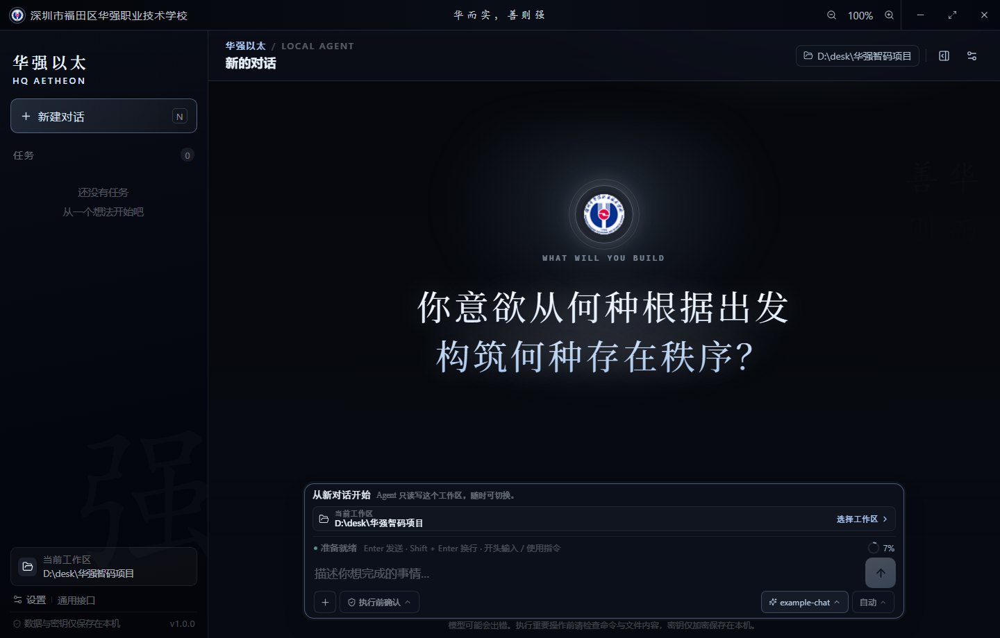
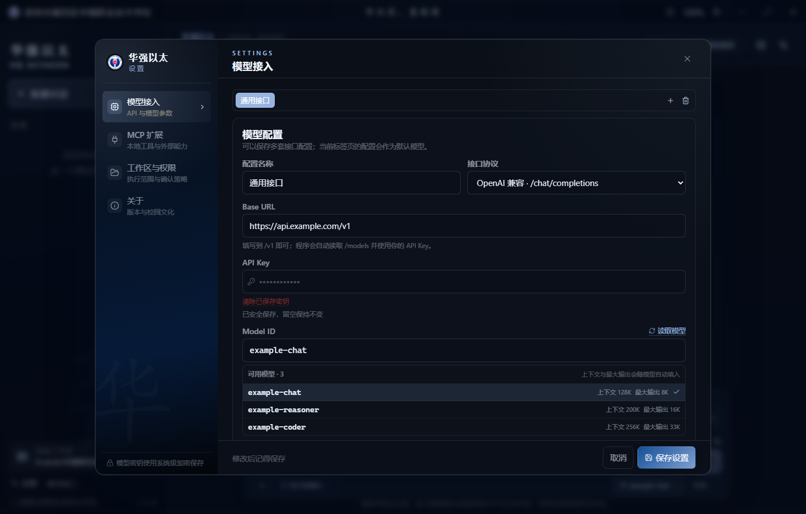

# 华强以太 · HQ Aetheon

[](https://www.gnu.org/licenses/gpl-3.0.html)

> 华而实，善则强。

华强本地 AI 编程与系统助手，Windows 桌面应用。可以读写文件、修改代码、执行命令、浏览网页，并通过 MCP 调用外部工具。(:))



## 功能

- **本地桌面应用**：Electron + React，不依赖浏览器打开
- **Agent 工具调用**：文件读写、精确编辑、搜索、PowerShell、系统信息、网页抓取
- **多模型配置**：OpenAI 兼容接口 / Anthropic Messages，支持读取 `/models`
- **流式输出**：思考过程、工具步骤、执行结果实时显示
- **对话与工作区**：一个工作区对应一个项目，对话记录独立保存
- **附件**：文本、图片、PDF；支持 Windows OCR
- **权限审批**：写文件、执行命令、访问网络、调用 MCP 前可确认
- **内置 MCP**：Python、Excel、Word、PPT、PDF、图片处理
- **便携 Python**：随项目下载，不依赖用户电脑安装办公库
- **安装包**：便携版 exe 和 Windows 安装版

## 前置条件

| 条件 | 要求 | 用途 |
| --- | --- | --- |
| 系统 | Windows 10/11 x64 | 不支持 32 位 |
| Node.js | 22.12 或更高 | 安装依赖、启动 Electron |
| npm | 随 Node.js 安装 | 下载前端依赖 |
| Python | 3.12 | 仅首次准备便携 Python 时需要 |
| .NET Framework | 4.8 | 仅打包 exe 时需要 |
| 网络 | npm / PyPI / 华为云镜像 | 下载依赖 |
| 磁盘 | 至少 1.2GB 可用空间 | 依赖约 620MB，便携 Python 约 277MB |

检查版本：

```powershell
node --version
npm --version
python --version
```

下载地址：

```text
Node.js: https://nodejs.org/
Python:  https://www.python.org/downloads/
```

安装 Python 时勾选：

```text
Add python.exe to PATH
```

## 获取代码

### 方式一：Git

```powershell
git clone https://github.com/HUANGGUOHHUA/HUAQIANG-AGENT.git
cd HUAQIANG-AGENT
```

### 方式二：下载 ZIP

在 GitHub 页面点击：

```text
Code → Download ZIP
```

解压后进入项目目录。

## 下载依赖

推荐直接双击：

```text
下载依赖\下载依赖.bat
```

或在项目根目录执行：

```powershell
powershell -NoProfile -ExecutionPolicy Bypass -File .\下载依赖\下载依赖.ps1
```

脚本会自动：

1. 检查 Node.js 和 npm
2. 执行 `npm install`
3. 下载 Python 3.12 embeddable
4. 安装便携 Python 到 `runtime/python`
5. 安装办公、数据、图片、PDF 依赖
6. 检查所有 Python 包能否导入

如果 `runtime/python` 已完整，脚本会跳过 Python 下载。

强制重新安装便携 Python：

```powershell
powershell -NoProfile -ExecutionPolicy Bypass -File .\下载依赖\下载依赖.ps1 -Force
```

### 手动安装

不使用一键脚本时：

```powershell
npm install
npm run prepare:python
```

注意：`npm run prepare:python` 会删除并重建 `runtime/python`，需要系统 Python 3.12。

## 启动开发版

```powershell
npm run dev
```

启动成功后会打开：

```text
华强以太 · 华强职校 AI 编程助手
```

开发服务器默认地址：

```text
http://localhost:5173/
```

## 首次配置

### 默认接口

源码默认写死：

```text
Base URL: http://10.1.0.10:8080/v1/chat/completions
Model:    swift-1.5-iq2_xs
上下文窗口: 128000
最大输出:   128000
```

默认 API Key 已内置，不需要手动填写。

### 添加其他模型

1. 点击左下角「设置」
2. 打开「模型接入」
3. 点击 `+` 新建配置
4. 填写 Base URL、API Key、Model ID
5. 点击「读取模型」可以自动读取模型列表
6. 选择当前使用的配置
7. 点击「保存设置」

其他配置保存在本地：

```text
data/settings.json
```

不会上传到 Git。

## 使用教程

### 新建对话

点击左侧「新建对话」，输入任务，例如：

```text
读取这个项目并说明主要模块
```

```text
帮我修复 TypeScript 类型错误
```

```text
把这个 Excel 转成 CSV
```

### 选择工作区

点击输入框上方的「选择工作区」，选择代码或文件所在目录。

Agent 只能操作工作区内的文件，不能随意访问其他路径。

### 添加附件

点击输入框下方的回形针，可以添加：

- 文本文件
- 图片
- PDF

视觉模型会直接接收图片；不支持视觉时会回退到 Windows OCR。

### 权限审批

执行写文件、删除、PowerShell、网络请求等操作前，可能弹出确认框。

- 允许一次
- 拒绝
- 进入自动模式后减少确认

### 停止任务

任务运行时点击发送按钮旁的停止按钮，可以终止本轮执行。

### 工具步骤

思考过程、工具调用和结果会显示在消息流中。任务完成后步骤会自动收起。

### 对话记录

每个对话单独保存：

```text
data/conversations/<会话ID>.json
```

左侧「对话记录」可以重新打开历史对话。

### Python / Office 工具

内置工具可以处理：

- Excel：openpyxl、pandas、XlsxWriter
- Word：python-docx
- PPT：python-pptx
- PDF：pypdf、pdfplumber、reportlab
- 图片：Pillow
- 数据：numpy、matplotlib

首次使用前请确认已经执行过：

```text
下载依赖\下载依赖.bat
```

## 常用命令

| 命令 | 作用 |
| --- | --- |
| `npm run dev` | 启动开发窗口 |
| `npm run typecheck` | TypeScript 类型检查 |
| `npm test` | 运行测试 |
| `npm run build` | 构建到 `out/` |
| `npm run prepare:python` | 重建便携 Python |
| `npm run pack` | 生成便携版到 `output/` |
| `npm run installer` | 生成安装版到 `output/` |
| `npm run pack:dir` | 生成可直接运行的目录 |

## 测试

```powershell
npm run typecheck
npm test
```

当前：15 个测试文件，62 个测试通过。

UI 冒烟测试：

```powershell
npm run build
node tests/ui-server.cjs
node tests/ui-features.cjs
```

## 打包

```powershell
npm run pack
npm run installer
```

输出：

```text
output/
  HuaqiangAgent-1.0.1-portable.exe
  HuaqiangAgent-1.0.1-setup.exe
  win-unpacked/
```

打包前需要：

- 已执行 `npm install`
- 已执行 `npm run prepare:python`
- Windows 已安装 .NET Framework 4.8

安装器不会自动启动应用，安装完成后由用户从桌面或开始菜单打开。

## 更新代码

```powershell
cd HUAQIANG-AGENT
git pull
npm install
```

如果 `package-lock.json` 或 Python 依赖发生变化，重新执行：

```text
下载依赖\下载依赖.bat
```

## 常见问题

### `node` 不是内部或外部命令

Node.js 没有安装或没有加入 PATH。重新安装 Node.js 后打开新的终端。

### `npm install` 下载 Electron 失败

可能是网络问题。可以设置 npm 镜像后重试：

```powershell
npm config set registry https://registry.npmmirror.com
npm install
```

### `python` 不是内部或外部命令

安装 Python 3.12，并勾选 Add python.exe to PATH。

### Python 运行时损坏

```powershell
powershell -NoProfile -ExecutionPolicy Bypass -File .\下载依赖\下载依赖.ps1 -Force
```

### 端口 5173 被占用

关闭残留的 Electron 或 Node 进程后重新执行：

```powershell
npm run dev
```

### 页面空白或缓存异常

关闭应用，删除 `.dev-profile` 后重新启动。该目录只包含开发缓存，不包含 `data` 中的配置和对话。

### API 连接失败

检查：

- Base URL 是否以 `/v1` 或完整接口地址结尾
- API Key 是否有效
- 模型 ID 是否存在
- 是否能访问该地址

## 目录结构

```text
app/
  src/
    main/                 Electron 主进程
      agent/              Agent 循环、提示词、模型适配、工具
      attachments/        图片 / PDF / OCR
      security/           工作区路径隔离
    preload/              contextBridge API
    renderer/             React 界面
      src/
        components/       界面组件
        lib/              前端工具函数
    shared/               共享类型

installer/                C# 启动器与安装器源码
  launcher/
  setup/

下载依赖/                 一键安装依赖脚本
scripts/                  构建、签名、Python 运行时脚本
tests/                    Vitest 与 UI 冒烟测试
build/                    exe 图标
resources/                应用资源
docs/                     文档与截图

data/                     本地配置与对话，不提交
.dev-profile/             Chromium 缓存，不提交
runtime/                  便携 Python，不提交
out/                      构建缓存，不提交
output/                   打包输出，不提交
```

## 数据与隐私

- 不收集遥测
- 模型请求直接发送到配置的 API 地址
- API Key 使用 Electron `safeStorage` 加密保存
- 默认接口的 Key 位于源码中的默认配置
- `data/` 和 `data/conversations/` 不会上传到 Git
- 开发缓存位于 `.dev-profile/`

## 许可证

本项目采用 **GNU General Public License v3.0 only**，SPDX 标识：

```text
GPL-3.0-only
```

完整条款见 [LICENSE](LICENSE)，版权声明见 [COPYRIGHT](COPYRIGHT)。

你可以自由使用、修改和分发本项目。分发修改后的版本时必须继续使用 GPLv3，并提供对应源代码。本项目不提供任何担保。




